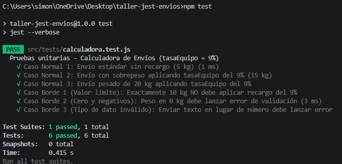

# Taller Final - Calidad del Desarrollo de Software (CIAF)

Proyecto de pruebas unitarias automatizadas con **Jest** y control de versiones con **Git/GitHub**.

## Integrantes del Equipo (Orden Alfabético)

| N° Lista | Apellidos | Nombres |
| :---: | :--- | :--- |
| **9** | Guapacha Quintero | Jhon Fredy |
| **20** | Rivillas Largo | Cristian David |

* **Valor de $N$:** `9` (correspondiente al primer integrante en orden alfabético).
* **Cálculo de `tasaEquipo`:** $(9 \bmod 5) + 5 = 4 + 5 = \mathbf{9\%}$

---

## Descripción del Negocio: Servicio de Envíos "RapiEnvíos CIAF"

El módulo calcula el costo de envío de paquetes según su peso en kilogramos bajo las siguientes reglas:
1. **Tarifa Base:** `$10.000 COP` fijos por envío + `$2.000 COP` por cada kilogramo.
2. **Recargo por Sobrepeso (`tasaEquipo` = 9%):** Si el paquete pesa **más de 10 kg** (`peso > 10`), se cobra un recargo adicional del **9%** sobre el subtotal del envío.
3. **Validaciones de Seguridad:** No se permiten pesos menores o iguales a `0 kg`, valores no numéricos, ni paquetes superiores a `50 kg`.

---

## Casos de Prueba Unitarios (Patrón AAA)

| # | Tipo | Descripción del Caso | Entrada (`peso`) | Salida Esperada |
| :---: | :--- | :--- | :---: | :--- |
| 1 | Normal | Envío estándar sin recargo | `5` | `20000` |
| 2 | Normal | Envío con sobrepeso (aplica 9% de `tasaEquipo`) | `15` | `43600` |
| 3 | Normal | Envío pesado (aplica 9% de `tasaEquipo`) | `20` | `54500` |
| 4 | Borde | Valor justo en el límite (10 kg exactos, sin recargo) | `10` | `30000` |
| 5 | Borde | Peso en cero | `0` | Error: `El peso debe ser mayor a 0 kg.` |
| 6 | Borde | Tipo de dato inválido (string) | `"15kg"` | Error: `El peso debe ser un valor numérico válido.` |

---

## Evidencia de Ejecución (`npm test`)

